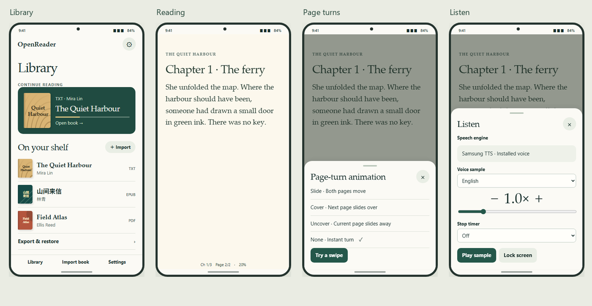

# Sam’s OpenReader

OpenReader is a personal Android book reader project for Samsung phones. The design supports EPUB, TXT and PDF, with customizable TXT chapter detection and read-aloud through Samsung TTS.

The project now includes an initial native Android alpha. Download an APK from [Releases](https://github.com/samzhangubc/Sam-s-OpenReader/releases) and read its [feature coverage and limitations](docs/RELEASE-NOTES.md) before installation. The alpha supports Android 15 and newer.

Read the [software design document](docs/SDD.md) for the intended product requirements. Download and open [the interactive HTML preview](docs/preview.html) in a browser to explore an earlier design with sample books and simulated playback.

Build with JDK 17, Android SDK 35 and Gradle 8.11.1 using `gradle :app:assembleDebug :app:lintDebug`. GitHub Actions builds the APK and runs an Android 15 emulator smoke test.

## License and support

OpenReader is provided free of charge under the [MIT License](LICENSE). This personal project is provided without a service-level agreement, guaranteed response time, or promise of indefinite maintenance.
