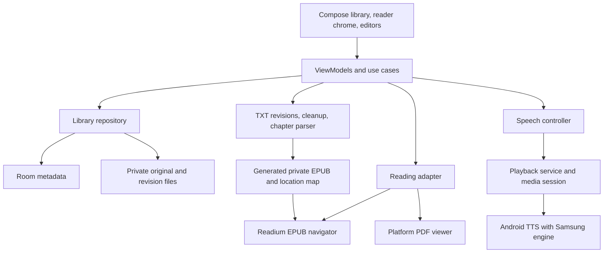

# OpenReader — Software Design Document

Version: 0.5 • Date: 2026-11-16 • Status: proposed design, ready for implementation planning

## 1. Purpose and assumptions

Build an offline-first Android book reader for Samsung Galaxy phones, with EPUB, TXT, and PDF import; an independent local library; editable TXT chapter detection and bulk cleanup; Samsung Text-to-Speech (TTS); and a customizable paginated reading experience.

This document specifies the software; it does not claim that an application or device prototype already exists. The project workspace was empty when inspected. Requirements below distinguish requested behavior from proposed defaults and capabilities that need a device experiment.

Proposed defaults:

- Native Android application using Kotlin, Jetpack Compose, and Android platform services.
- Primary device: the user's Samsung Galaxy A56 5G, North American edition. Record the actual model code, RAM, carrier/CSC, firmware build, WebView version, and installed Samsung TTS version during device validation; do not infer these from an international model.
- Primary compatibility baseline: Android 16/API 36 with One UI 8.0, interpreting “one year older” as the previous annual major release, not exactly 365 days or a particular monthly security patch. Also test available One UI 8.x maintenance releases and forward compatibility with Android 17/One UI 9. No core feature may require the newest release.
- Retain the proposed Android 10/API 29 installation floor for broader compatibility, with API-gated fallbacks. Full Samsung-device certification is required on the A56 baseline; older Android versions require their own compatibility tests and are not implicitly certified by that result. Phones first; responsive tablet and foldable layouts remain secondary.
- Local books and settings; no account, server, ads, or cloud synchronization in the first release.
- DRM-free files. Encrypted/DRM EPUBs and password-protected PDFs receive a clear unsupported-file message in version 1.
- Fully localized interface and reading workflows in English, Simplified Chinese, and Traditional Chinese, independent of the device's language. Unicode content in other languages/scripts and emoji must remain displayable through the coverage/fallback contract in section 5.2.
- Samsung official TTS is the only supported speech engine. Other installed engines can be identified but are not required to work.
- Resource efficiency is a first-release requirement, particularly for screen-off Samsung TTS: bounded text buffers, no active page rendering during background listening, and measured CPU, memory, and battery targets.

Samsung documents the current Android 17/One UI 9 generation and the previous Android 16/One UI 8 generation. Those sources establish the baseline interpretation, not the installed firmware or rollout status of the user's North American handset. [Current generation](https://www.samsung.com/in/support/mobile-devices/one-ui-software-update/), [Previous generation](https://news.samsung.com/global/samsung-launches-one-ui-8-beta-program-the-first-generation-upgrade-starting-with-the-new-galaxy-foldables). Samsung's US A56 announcement lists an 8 GB/128 GB configuration; use the user's actual hardware rather than assuming every North American unit has that configuration. [Samsung US A56 announcement](https://news.samsung.com/us/samsung-new-galaxy-a56-a36-a26-5g-marks-step-forward-with-ai-for-everyone/).

## 2. Reading-app documentation review

Research reviewed on 2026-11-16. These are documented behaviors, not results of installing or testing the competing apps. Availability can vary by edition and release. The proposed defaults in later sections are OpenReader design decisions, not claims that the references implement them identically.

| Reference | Documented behavior relevant to this app | Design implication |
| --- | --- | --- |
| Moon+ Reader | Local TXT/EPUB/PDF support, visual customization, configurable taps/swipes, bookshelf import, and reader-bar customization. Its FAQ describes TTS and headset/Bluetooth controls among Pro features. | Use an immersive reading surface with configurable controls and readily available reading settings. |
| Librera | Documentation explicitly covers adjustable tap zones, center-tap menus, chapter/page status information, and TTS replacements using literals or regular expressions. Backup documentation lists settings, bookmarks, progress, and tags. | Provide editable interaction zones, a small persistent footer, and explicit previews. Distinguish actual book-file export from settings/progress backup. |
| FBReader | Its Android FAQ documents SAF file access, integrated PDF and automatic reading aloud in Premium, and troubleshooting background TTS operation. | Use Android's file picker and make background listening a tested feature. |
| ReadEra | Documents library collections/sorting, chapter navigation, chapter page counts, typography for text formats, and PDF zoom/cropping. | Keep library organization simple and distinguish reflowable text settings from PDF controls. |

Sources: [Moon+ features](https://www.moondownload.com/), [Moon+ FAQ](https://www.moondownload.com/faq.html), [Librera tap zones](https://librera.mobi/faq/tap-zones-configuration/), [Librera status bar](https://librera.mobi/faq/how-to-set-up-a-status-bar/), [Librera TTS replacements](https://librera.mobi/faq/tts-replacements/), [Librera backup](https://librera.mobi/faq/backup-import-export-migration/), [FBReader FAQ](https://fbreader.org/faq), [ReadEra features](https://readera.org/).

OpenReader's main emphasis is the requested combination of whole-book TXT cleanup, chapter-rule tuning while reading, and library copies independent of their external source. This review does not establish that competing apps lack those functions.

## 3. Scope and requirements

All rows are first-release requirements unless a qualification is explicitly stated.

| ID | Requirement | Completion criterion |
| --- | --- | --- |
| IMP-01 | Import EPUB, TXT, and PDF through the file picker, Android Open with, and supported Share intents. | Valid fixtures open; malformed files fail without partial library entries. |
| LIB-01 | Offer Open once or Add to library when opening an external book. | Only adding commits a permanent app-owned copy. |
| LIB-02 | Library content is independent of external files. | Renaming, changing, or deleting the source does not alter the library book. |
| LIB-03 | Search, sort, reopen, remove, and export library books. | Progress persists; export creates a user-chosen output; removal never deletes the external original. |
| TXT-01 | Detect TXT chapters semi-automatically. | User sees candidate headings and approves the resulting contents. |
| TXT-02 | Adjust detection while reading. | Presets, simple rules, advanced patterns, and manual corrections are available without reimporting. |
| TXT-03 | Replace or delete strings throughout an imported TXT. | Whole-book preview, counts, apply, cancel, undo, and original restoration work. |
| TTS-01 | Read using installed Samsung TTS. | Language/voice checks and a sample precede playback; missing support has an actionable error. |
| TTS-02 | Include a speed dial and stop timer. | Rate changes, countdown, end-of-chapter stop, pause/resume, and stop behave as specified below. |
| UI-01 | Set font, font size, text color, and background color. | TXT/reflowable EPUB updates preserve the reading position; fixed-layout limitations are visible. |
| NAV-01 | Navigate chapters and return to the last reading location. | Contents, previous/next chapter, and resume use persistent content locations. |
| NAV-02 | Swipe pages; tap left/right to go backward/forward; tap center to toggle bars. | Gestures do not conflict with text selection, links, PDF zoom, or system navigation. |
| NAV-03 | Small footer shows chapter number, page in chapter, and book percentage. | Values follow the definitions in section 8 and update after layout/content changes. |
| NAV-04 | Choose Slide, Cover, Uncover, or None for adjacent page turns. | The choice persists. A finger swipe left advances one page and a finger swipe right returns one page in every mode and supported format. |
| LANG-01 | Fully support English, Simplified Chinese, and Traditional Chinese UI and workflows. | All screens/errors/accessibility labels are localized; app language and content language are independent. |
| LANG-02 | Preserve Unicode characters and display registered graphic characters/emoji through font fallback. | Versioned coverage tests, grapheme-safe edits, and explicit missing-glyph diagnostics satisfy section 5.2. |
| PARSE-01 | Generalize chapter detection beyond fixed language-specific title prefixes. | Examples, structural/numbering rules, hierarchy, and manual overrides work on the fixtures in section 5. |
| PERF-01 | Background speech uses limited app CPU/memory and no reader renderer. | A56 screen-off benchmarks meet the app-owned budgets in section 11; Samsung engine costs are separately measured. |
| COMPAT-01 | Core functions work on the A56 with the previous annual Android/One UI release. | Physical-device baseline tests pass without APIs exclusive to Android 17/One UI 9. |

### Format support boundaries

| Capability | TXT | Reflowable EPUB | PDF / fixed-layout EPUB |
| --- | --- | --- | --- |
| Local import/export | Yes | Yes | Yes |
| Font, size, text/background colors | Full control | User style overrides, with publisher-style reset | Viewer background, zoom, optional night filter; document typography is retained |
| Chapter navigation | Detected and manually editable | Published contents; spine fallback | Document outline if available; otherwise page navigation |
| Whole-book content replacement | Yes | Out of scope | Out of scope |
| Samsung TTS | Yes | Extractable text | Conditional on accessible text and extraction support; see section 9 |

PDF font replacement/reflow, scanned-page OCR, EPUB content editing, cloud sync, stores/OPDS, translation, DRM support, and audio-file generation are deferred. Basic bookmarks and in-book search are proposed supporting features; elaborate annotations are deferred.

## 4. Main screens and workflows

### 4.1 Library

Default screen: Continue reading, searchable book list/grid, and Import action. Each entry shows cover or generated placeholder, title, author if present, format, and progress. Sort by recent, title, author, or import date. Book actions: details, rename display metadata, export, and remove local copy.

Removal shows exactly what is deleted: app copy, edits, and saved reading state. Provide a short undo window before final deletion. Never invoke deletion on the source URI.

### 4.2 Import and Open once

Tapping **Import** opens the phone’s system document browser directly with `ACTION_OPEN_DOCUMENT` and `CATEGORY_OPENABLE`. Request TXT, EPUB and PDF. Offer an All files filter for providers that report generic types, then validate the selected content. Cancel returns to the library with no new entry. Opening a file from Samsung My Files enters the same import flow through Open with.

1. Receive the selected file or granted content URI. Check PDF and EPUB signatures/container structure. TXT has no file signature. For a plausible text file with a generic MIME type, show the decoding preview and let the reader confirm TXT. On expired access offer Choose file again.
2. Present Open once / Add to library. Library Import preselects Add to library.
3. Stream into a private staging file with cancellation and free-space checks. A temporary snapshot also makes Open once stable for the current session.
4. TXT shows encoding and paragraph previews followed by chapter suggestions. Users can accept, revise, or continue as one chapter.
5. For library import, commit verified files and metadata atomically. Open once stays temporary and visibly offers Add to library.
6. Start at the beginning or the existing book's saved location if the user selected an exact duplicate.

Use a content hash to offer Open existing / Import separate copy for duplicates. Filename equality does not establish a duplicate. If an Open once session is added later, promote its current snapshot and approved edits rather than rereading a possibly changed source.

Open once content survives for the reading session, including while the playback service is reading with the screen off. The screen and service share ownership of the temporary file. Close it after the last owner releases it and clean abandoned sessions on next launch. Promotion to the library hands playback the permanent copy at the same locator before releasing the temporary file. An Open once session can preview cleanup and promote itself before Apply. Removing a library book that is playing first stops its speech, saves its position, and closes its file handles before the removal/undo flow.

### 4.3 Reader

Illustrative layout, with bars shown:

```text
┌─────────────────────────────────────────┐
│ Back     Book title              ⋮      │
├─────────────────────────────────────────┤
│                                         │
│               Chapter title             │
│                                         │
│             Reading content             │
│                                         │
│                                         │
├─────────────────────────────────────────┤
│     Contents       Aa       Listen      │
└─────────────────────────────────────────┘
```

In reading mode the small footer shows chapter, page and book percentage. A center tap reveals the top bar and brings a floating three-action menu up from the bottom edge, above the system gesture inset. The menu covers the footer’s space while open. Dismiss by center tap, downward drag, or Back to restore the footer. Keep the page layout and locator fixed throughout. With reduced motion, show and hide the menu immediately. Settings, contents, and TTS use sheets; text selection uses a contextual menu.

Reader menu includes Chapter detection and Clean up text for TXT. Appearance changes have a live sample, global defaults, optional per-book overrides, and Reset.

**Finding a place.** Contents opens at the current entry and offers previous/next chapter. For PDF, Contents also accepts a one-based page number. Search opens matches in context in TXT, EPUB, or PDF pages with extractable text. Show an empty result separately from unavailable text extraction. A user can bookmark the visible location, revisit it from Contents, or remove it. After a search, bookmark, internal link, or contents jump, offer Return to previous location. A failed destination keeps the current passage visible.

### 4.4 Chapter editor

Show detection settings beside a navigable candidate list: line text, line number, included/excluded state, and reason for matching. Selecting a candidate opens surrounding paragraphs. User can add a boundary at a chosen line, exclude a false match, rename a chapter, or merge chapters by removing a boundary. Source text order cannot be changed here.

Offer “Use this as a heading” and “This is body text” on selected examples, a simple rule builder, and an advanced pattern editor. Preview on the current passage first, then scan the whole book on request. Explain the suggested pattern before applying it. Users may assign hierarchy levels such as Volume → Part → Chapter → Section, or use a flat contents list.

Re-running detection retains manual decisions where their anchors still resolve and lists unresolved decisions. Apply displays additions/removals, preserves the content position, and updates contents. Cancel leaves the book unchanged. Saved profiles can be reused across books.

### 4.5 Whole-book cleanup

Find → replacement (empty means delete) → preview → Apply to entire book. Literal matching is the default; optional case-sensitive, whole-word, and advanced regular-expression modes are explicit. Whole-word semantics are language dependent; disable that option for scripts without reliable boundaries and explain why.

Show total replacements, affected chapters, before/after context, and warnings when chapter titles or the current reading location are affected. Results are sampled for display but counted across the entire book. A rule list may apply several replacements in a declared order; each rule operates once on the previous rule's output. No recursive replacement.

Provide Undo last batch, revision history, and Restore original TXT. Restoration creates another revision rather than destroying history. Book cleanup changes visible text, search, and speech together. Speech-only pronunciation substitutions are a future separate feature.

## 5. TXT decoding and chapter detection

### 5.1 Decoding and canonical text

Preserve original bytes unchanged. Detect BOM first; otherwise try strict UTF-8, then offer a best-effort encoding suggestion and preview. Manual options initially include UTF-8, UTF-16 LE/BE, GB18030, Big5, and Windows-1252, subject to decoder availability. Never silently accept replacement characters as a successful decode.

The working representation uses Unicode and LF line endings. Preserve paragraph boundaries and punctuation by default; line joining, trimming, and removing blank lines are opt-in operations with previews. Store the decoder choice. Changing it after editing requires previewing a new branch from the original and does not silently discard edits. Required Chinese import tests include GB18030 and Big5, including supplementary characters and vendor-specific extensions: unsupported decoder mappings must be disclosed, not replaced silently.

### 5.2 Languages, Unicode, and font coverage

The interface offers English (`en`), 简体中文 (`zh-Hans`), 繁體中文 (`zh-Hant`), and Follow system. Resolve locale/script fallbacks explicitly, including region-specific Chinese locales; do not infer book script from the interface locale. No automatic Simplified/Traditional conversion of stored content. Localize examples, parser explanations, number/date formatting, notifications, and TalkBack labels, not just menu names. Support horizontal Chinese reading initially; vertical typography is a separate future feature.

“All registered characters” means valid assigned Unicode graphic characters and standardized emoji sequences in a declared Unicode release, rather than an ASCII/CJK whitelist. Use Unicode 18.0/Emoji 18.0 as the initial coverage target, with version-pinned data and a recorded font-coverage manifest. Preserve all valid Unicode scalar values even when a future version assigns new ones. Control/format characters obey layout semantics rather than requiring visible glyphs; private-use characters need an author/user-supplied font because Unicode does not prescribe their appearance. [Unicode release](https://www.unicode.org/versions/Unicode18.0.0/), [Emoji specification](https://www.unicode.org/reports/tr51/tr51-31.html).

- Use selected book font → script-appropriate fallback → installed coverage pack. Traditional Chinese fallback must support regional glyph forms; do not substitute a Simplified Chinese face indiscriminately.
- Test rare CJK extension-plane characters, compatibility ideographs, combining marks, variation selectors, supplementary-plane scripts, bidirectional text, and mixed-script punctuation. Do not strip joiners, variation selectors, or accents during decoding, editing, or export.
- Treat extended grapheme clusters as the user-visible unit for selection, deletion boundaries, truncation, and speech chunk boundaries; storage offsets remain UTF-16. Emoji tests include ZWJ families/professions, skin tones, flags, keycaps, and text/emoji presentation. Preserve the exact original sequence. [Unicode segmentation](https://www.unicode.org/reports/tr29/tr29-49.html).
- Older system fonts may lack newly assigned glyphs. Bundle core English/Simplified/Traditional coverage and an offline-capable emoji fallback; allow explicitly installed, versioned offline font packs for uncommon scripts and rare CJK ranges. Load only needed faces/ranges and bound caches. No automatic network font lookup during reading or speech.
- Verify fallback in both Compose controls and the EPUB WebView. Emoji2 support in native text does not establish WebView support; renderer-specific color-font/emoji fallback must be tested. Font assets may be shared on disk rather than copied per book. [Android modern emoji support](https://developer.android.com/develop/ui/views/text-and-emoji/emoji2).
- Never claim universal visual coverage based only on UTF-8 acceptance. The release report lists tested Unicode ranges/emoji sequences and missing coverage. If an installed font cannot render a character, preserve it, show a detectable placeholder with code-point details, and offer a compatible font/pack. This is graceful degradation, not successful glyph coverage; complete target coverage requires the relevant packs and passing shaping tests. Font licensing and available glyph data are implementation decision gates.

Display support does not imply TTS pronunciation support. Samsung voice availability determines spoken languages and rare-character/emoji pronunciation; the app must preserve text regardless.

### 5.3 Generic chapter model and detection profile

```text
ChapterProfile
  id, version, name
  enabledPresets[], matchingNormalization
  rules[{ id, priority, kind, scope, pattern?, numberingGrammar?,
          titleCapture?, numberCapture?, level, enabled }]
  context{ maxHeadingLength, surroundingBlankLines, indentation,
           maxBlockLines, separatorPatterns, minimumChapterLengthWarning }
  numbering{ allowedSystems[], sequencePolicy, restartAtParent }
  positiveExamples[], negativeExamples[]
  manualIncludes[], manualExcludes[], titleOverrides[]
```

The parser recognizes configurable structure, not a single “chapter” keyword. Rules may combine heading text, numbering, separators, whitespace/indentation, neighboring headings, and book-local examples. Users can disable any cue. Initial preset families:

| Family | Examples and behavior |
| --- | --- |
| Named and numbered | `Chapter 12`, `CHAPTER XII`, `Book II`, `Part Three`, `Section 4`, configurable prefixes in any language |
| Chinese script variants | `第十二章`, `第壹拾貳回`, `第１２節`, `第二卷`, `序章`, `楔子`, `後記`/`后记`, `番外` |
| Bare numbers | `12`, `XII`, `十二`, `壹拾貳`, `一、`, `(3)`, `（三）`; opt-in because of false positives |
| Hierarchical numbering | `1.2`, `1.2.3`, `三.二`; assign levels using explicit book-specific rules |
| Decorated headings | `【第十二章】`, `—— Chapter 3 ——`, `*** Prologue ***`; configurable wrappers/separators |
| Unnumbered titles | Short isolated title lines, user-marked examples, named front/back matter; require context and review |
| Multiple-line blocks | A number line followed by a title, or heading between separator lines; bounded block matching, default maximum 3 lines |
| Explicit delimiters | Form feed or user-selected separator as a proposed boundary; scene breaks such as `***` are not chapters by default |

Number parsing is separate from matching. Support ASCII/fullwidth decimal, Roman, English number words, Chinese common and financial numerals, and user-defined token sets. Validate grammar; do not treat any run of Roman letters or Chinese numerals as a valid number. Sequence checks produce warnings, allowing skipped/repeated numbers and resets at a parent boundary. Mixed formats may coexist in the same book.

Optional matching-only normalization can fold width, English case, and selected whitespace/wrappers, or equate configured Simplified/Traditional heading tokens. Keep a mapping to original spans; do not normalize or convert stored book text. Use specific token equivalences rather than claiming generic Simplified/Traditional equivalence. Numbered/title captures and displayed titles reference the original text.

Example-guided detection is deterministic and local: derive bounded rule suggestions from the selected heading's literal parts, number position, wrappers, and context; test them against positive/negative examples. Show conflicts and require approval. Do not infer a universal rule from one example or run a generative model continuously. Save accepted rules as a profile; changes remain scoped to the current book unless explicitly saved as a shared preset.

**Build a rule from blocks.** In Chapter detection, choose Add rule, then add, remove, reorder or edit blocks. Each row shows the operation and its editable value. Offer Starts with, Contains anywhere on this line, Number, One of, Optional title, Ends here, and Exclude if. Required blocks combine with AND. Token blocks consume adjacent text in order. Contains and Exclude inspect the same line without moving the token cursor. Show the failing block or matched spans next to each example. Save the rule to this book or a named profile.

```text
FOR EACH physical line                 // strict numbered-heading preset
  MATCH ON trimmed, width-folded copy    // keep original offsets and title
  STARTS WITH   [第]
  READ NUMBER   [decimal digits OR Chinese numerals]   // longest valid token
  THEN ONE OF   [章 | 回 | 节 | 節]      // must immediately follow the number
  OPTIONAL TITLE
    AFTER       [whitespace OR ： OR : OR —]
    LENGTH      [1..32 grapheme clusters]
  ENDS HERE
  EXCLUDE IF    [line ends with 。！？.!?]             // editable
  ON MATCH      suggest chapter at original line start
  OTHERWISE     keep as body text
```

With this preset, `第１２節：歸途` and `第十二章 山雨` are candidates. `我在第十二章读到这句话。` fails Starts with. `第三天他读完了这一章` fails the marker immediately after the number even though the line starts with 第 and contains 章. `第十二章讲的是回家` fails the title separator. For books with legitimate unspaced titles, allow an empty separator and flag those matches for review. An English profile can use `Chapter` + required space + decimal or Roman number + optional separated title. A short sentence such as `Chapter 2 was difficult` can still fit that shape. Show surrounding lines and allow **This is body text** to persist an exclusion. Blank-line context, repeated heading shape and number sequence help rank ambiguous matches. A preview always precedes a change to the chapter map.

### 5.4 Pipeline, hierarchy, and safeguards

1. Stream canonical text into a disk-backed line/offset index. Do not retain the entire book as line objects. Retain only the bounded context window needed by active rules.
2. Extract candidates using inexpensive structural/token checks before advanced patterns. Match complete lines or explicitly bounded heading blocks. Report skipped oversized candidates and configured candidate-limit truncation.
3. Parse optional number/title captures and hierarchy level. Rank using visible, deterministic cues: rule specificity, isolation, repeated heading shape, and sequence consistency. The same text/profile version must yield the same results.
4. Flag likely repeated TOC listings using dense heading groups, dot leaders/page suffixes, and later matching body headings. Also flag dialogue/body sentences, scene breaks, page headers, and very short consecutive sections. Never silently discard a boundary solely because a heuristic dislikes it.
5. Resolve overlaps: explicit manual inclusion/exclusion first, then explicit rule priority, then more specific span. Exclusions win an exact-location conflict unless the user reverses that decision. Surface ambiguous overlapping multi-line matches for review rather than generating duplicate boundaries.
6. Build a hierarchy of navigation entries and a separate ordered partition of reading segments. Parent volume/part ranges may contain children, but leaf segments cover the book exactly once; parent-only text remains its own segment. An internal resource split never becomes a semantic chapter.
7. Include pre-heading content as Front matter; use one Book section when there are no headings. Retain heading/separator text. Empty or unresolved structural entries are flagged and do not produce empty reader pages.
8. Preview and commit a versioned map with stable entry IDs where anchors resolve. Rebuilding the map alone does not modify text. The footer counts the configured navigation level (Chapter by default); a book without that level uses its deepest nonempty section level and labels it accurately.

Use a bounded-time regex engine such as RE2/J if advanced rules ship, with a documented supported subset. Backreferences/lookbehind in match patterns are not assumed available. Replacement capture syntax is separately validated. Reject zero-length bulk matches in version 1. Bound pattern size, output size, candidate count, and execution work; cancellation must actually stop work rather than merely hide the dialog. Select and pin the dependency after a compatibility/license review.

Rule editing is debounced (proposed 400 ms) and cancels stale previews. Preview first within a bounded passage and indicate “sample only”; a full cancellable scan is required before Apply and provides whole-book counts. Cache the line index and reusable features by revision, recompute affected candidates, and rescan neighbors after a local edit. Global rules/normalization changes require a full pass. Full scans occur off the UI thread; only the latest result can be applied. Profile editing and chapter corrections remain available from the reader throughout the book's lifetime.

Parser acceptance fixtures must cover every family above, mixed Simplified/Traditional/English headings, alternating styles, malformed numbering, title-only books, prose with misleading numbers, repeated TOCs, heading blocks crossing read-buffer boundaries, parent-only introductory text, and manual overrides surviving reparsing. Each committed map must preserve all original text and partition readable segments exactly once.

## 6. Bulk-edit consistency and recovery

Each Apply operation works on a specific base revision. Build a new text file, offset mapping, proposed chapter map, and remapped locations in staging. Pause TTS before committing. A concurrent edit or stale preview must be rejected and regenerated.

Persist the new immutable revision and derived files first; then switch the active revision in a database transaction. A failure leaves the previous revision active. Clean orphan staging files on restart. Keep the original and at least the previous revision; expose history size and require an explicit user action to prune older revisions.

For every replacement, record source range and replacement length. Transform later offsets by cumulative deltas. Locations within removed/replaced text move to the start of the replacement or nearest surviving content. Remap progress, bookmarks, manual chapter decisions, and the TTS resume location. If context cannot resolve a manual boundary, flag it instead of silently moving it to an unrelated paragraph.

Re-run chapter detection on the new revision, reapply resolvable manual decisions, and present the changed boundaries before the combined text/chapter commit. Invalidate pagination, search, and TTS queues together. Exporting the edited TXT produces the current canonical text, not a recipe that another app cannot interpret.

## 7. Interaction and appearance

Horizontal controls use physical finger direction across all three interface languages. A page means one screenful at the current layout, or one fixed page in phone page-fit mode.

| Input | Behavior |
| --- | --- |
| Finger swipes left (right to left) | Next page in the book’s reading order |
| Finger swipes right (left to right) | Previous page in the book’s reading order |
| Tap left 30% / right 30% | Previous / next page |
| Tap middle 40% | Toggle bars |
| Long press | Select text where the format supports selection |
| Contents item | Navigate to its content location |
| Back | Close selection/sheet/bars first; then return to library |

Zones are adjustable with a visual preview and Reset. Use touch slop to distinguish a swipe from a tap and perform only one action per gesture. Links and selection take precedence. Respect Android edge-back navigation. In PDF, zoom/pan takes precedence when zoomed in; page gestures apply at page-fit. Expose labeled previous/next buttons for accessibility.

### 7.1 Page-turn animation

Open **Aa → Page-turn animation** to choose or preview a mode using two numbered sample pages. Propose Slide as the initial default. Save the app-wide choice with reader preferences. A book can inherit it or use a per-book override. Use localized labels for the four choices. The physical gesture mapping above also applies when an EPUB declares right-to-left progression. The adapter resolves next/previous in publication order and the transition follows the finger.

| Mode | Swipe left from page 5 to 6 | Swipe right from page 5 to 4 |
| --- | --- | --- |
| Slide | Pages 5 and 6 move left together, edge to edge, at the same speed. | Both pages move right together. Page 4 enters from the left. |
| Cover | Page 5 stays still. Page 6 slides in from the right over it. | Page 5 stays still. Page 4 slides in from the left over it. |
| Uncover | Page 5 slides off to the left, revealing stationary page 6 underneath. | Page 5 slides off to the right, revealing stationary page 4 underneath. |
| None | Keep page 5 still during the drag. Show page 6 immediately on a committed turn. | Keep page 5 still during the drag. Show page 4 immediately on a committed turn. |

The three animated modes track a single horizontal drag. On release, complete the turn if the final horizontal displacement exceeds one-third of the viewport. A shorter drag also commits when displacement exceeds touch slop and release velocity meets the device’s fling threshold in that direction. Returning to the starting point cancels. Treat system cancellation, a second pointer, or a layout change mid-drag as cancellation. With None the same recognition rules apply. A quick side tap or a previous/next button uses the selected transition. A center tap toggles the bars without moving the page. Contents, search, and automatic TTS jumps go directly to their destination. System reduced motion uses None while preserving the stored preference.

The reader owns one page turn at a time. A renderer exposes the current page, an adjacent destination and its locator, and a way to commit or cancel. A single gesture handler drives both layers and suppresses a duplicate native pager turn. Keep the bars and footer stationary. At a successful commit, update the displayed page, footer, visual resume position, and manual-navigation TTS behavior together. A cancellation leaves each at the original location. If the destination takes time to lay out, keep the last readable page visible until ready. If loading fails, offer Retry there. Discard late page results after closing the book or changing its layout.

### 7.2 Appearance and accessibility

TXT and reflowable EPUB have independent **Chinese typeface** and **English typeface** pickers. Each picker starts with the eight built-in families below. Imported fonts appear in a separate group. Show each face by name with a live mixed sample, e.g. “山雨・歸途 — Harbour 12 🌙”. Each picker accepts imported TTF/OTF and can reset independently. Apply the Chinese face to Han runs with Simplified/Traditional language-aware fallback and the English face to Latin runs. Keep combining marks with their base, resolve neutral punctuation from the surrounding run, and route emoji clusters through emoji fallback. Store both choices globally with independent per-book overrides. Other settings include size (proposed 12–48 sp), text/background colors, line spacing, margins, alignment, and day/night/sepia presets. Warn about poor contrast without preventing user choices. Invalid fonts fail safely. Use the versioned Unicode fallback/coverage contract in section 5.2, with script-appropriate glyph forms and emoji handling. Apply Chinese line-breaking/punctuation rules where supported and test mixed Latin/CJK wrapping without splitting grapheme clusters.

**Built-in font library.** The following families cover familiar book, academic, sans serif, handwritten and monospaced styles. The two columns are independent menus. Source Han Serif and Source Serif 4 are the initial selections. The list is an editorial selection for reading, with no implied usage ranking.

| Chinese picker | English picker |
| --- | --- |
| [Source Han Serif / 思源宋体](https://github.com/adobe-fonts/source-han-serif) — Song/Ming | [Source Serif 4](https://github.com/google/fonts/tree/main/ofl/sourceserif4) — book serif |
| [Source Han Sans / 思源黑体](https://github.com/adobe-fonts/source-han-sans) — Hei | [CMU Serif](https://ctan.org/pkg/cm-unicode) — Computer Modern Unicode, academic serif |
| [LXGW WenKai / 霞鹜文楷](https://github.com/lxgw/LxgwWenKai) — Kai, with the [TC edition](https://github.com/lxgw/LxgwWenKaiTC) | [Noto Serif](https://github.com/google/fonts/tree/main/ofl/notoserif) — general reading |
| [GenRyuMin / 源流明體](https://github.com/ButTaiwan/genryu-font) — Ming series | [EB Garamond](https://github.com/google/fonts/tree/main/ofl/ebgaramond) — old-style serif |
| [GenYoMin / 源樣明體](https://github.com/ButTaiwan/genyo-font) — Ming series | [Libre Baskerville](https://github.com/google/fonts/tree/main/ofl/librebaskerville) — screen-reading serif |
| [Huninn / 粉圓](https://github.com/justfont/open-huninn-font) — rounded | [Roboto](https://github.com/google/fonts/tree/main/ofl/roboto) — sans serif |
| [Iansui / 芫荽](https://github.com/ButTaiwan/iansui) — handwritten Kai | [Source Sans 3](https://github.com/google/fonts/tree/main/ofl/sourcesans3) — humanist sans |
| [Smiley Sans / 得意黑](https://github.com/atelier-anchor/smiley-sans) — slanted Hei | [IBM Plex Mono](https://github.com/google/fonts/tree/main/ofl/ibmplexmono) — monospace |

Ship actual font files, including the CMU Serif Roman face, in the base installation. All sixteen choices must work on first launch in airplane mode, regardless of Samsung system fonts, Google services or installed apps. Resolve stable family IDs to the same packaged assets in native previews and the EPUB renderer. When a family offers SC and TC variants, select by passage or book language under one menu entry. For glyphs missing from a specialty face, use the bundled region-appropriate Source Han fallback. Preserve emoji fallback from section 5.2.

Keep a manifest of the source release, file checksum, family/style, region, copyright notice and redistributable license for every shipped file. Include upstream notices in the app. Bundle regular reading faces first, share assets across books and load only the selected faces and necessary fallbacks. Record compressed install size and active reader memory on the A56. Background TTS must be able to run without loading any reader fonts.

Publisher-style override is explicit for EPUB and reversible. Fixed-layout EPUB/PDF keeps authored typography: explain why font controls are unavailable. Viewer background does not recolor an opaque PDF page; a separate night filter is a visual approximation and may alter images.

Use at least 48 dp targets for controls, TalkBack labels, and scalable toolbar text. A compact footer must remain readable and user-adjustable. With TalkBack touch exploration enabled, provide standard accessible actions instead of relying on hidden tap zones. Re-layout on rotation, split screen, or folding without changing the content anchor.

## 8. Pagination, locations, and progress

Page numbers are layout-dependent, so never persist a page number as the only reading position.

- TXT: revision ID + canonical UTF-16 offset + nearby text context. Maintain a mapping from canonical text to generated reading resources.
- EPUB: persistent publication locator containing resource href, fragment/text context, and progression as available. Do not assume a spine resource equals a chapter.
- PDF: zero-based document page index plus normalized within-page position; optional extracted-text offset for speech.

The renderer supplies visible-page start/end locators. Split TXT chapter resources further only when necessary for memory; resource splits must not create artificial chapters. Each TXT chapter starts on a fresh display page. For EPUB, chapter ranges come from the navigation document; a rendered page may intersect two ranges, and the chapter containing its first readable content owns the footer.

Footer example: `Ch 12 / 80 · Page 3 / 18 · 24.6%`, localized as appropriate (`第12章` and Simplified/Traditional page labels). Chapter counts follow the selected hierarchy level from section 5.4; the page/chapter calculation uses that entry's full content range, without double-counting nested entries.

For TXT/reflowable EPUB, page-in-chapter is the one-based index of the current rendered page intersecting the selected chapter's range. Chapter page totals require layout with the current font, viewport, spacing, and content version. Show `Page 3 / …` while totals are computing. Compute the active chapter on demand, not the whole book at startup; yield or defer large chapter totals while the user is turning pages. Cache by publication revision and layout signature, including font-pack version; never replace an unknown total with an estimate labeled exact. Background listening must not compute display pagination.

TXT percentage is the visible start offset divided by canonical text length. EPUB uses a documented, normalized publication-wide progression supplied by the selected adapter, not a chapter count average. PDF uses `(pageIndex + withinPageFraction) / pageCount`. Clamp values; empty content shows 0%, and reaching the explicit end sets 100%. Progress measures location, not proof that every preceding page was read.

For PDFs with chapter boundaries on different pages, chapter page number is relative to the outline's chapter start; an outline with multiple entries on the same page cannot provide an exact chapter page total, so omit the total or show a page range. With no outline, display `No chapters · Page 31 / 240 · 12.5%`. Fixed-layout EPUB uses document/spread page information and indicates unavailable chapter totals honestly.

On style changes, preserve the first visible content locator and recompute pages. On TXT edits, transform the locator as described in section 6. A pagination experiment must verify exact chapter-page counts with the selected EPUB renderer; its generic publication position count is not assumed to equal rendered page count.

**Reading order and endpoints.** Page forward from the last page of a chapter opens the first page of the next one. Page backward crosses the same boundary in reverse. At the start or end of a book, an outward turn stays on the same page. The final page displays 100% once reached, including a one-page book. Empty TXT opens an empty-state view at 0% with paging and Listen disabled. These rules also apply after deleting the entire working text. Undo remains available.

Use the EPUB linear spine for sequential turns. Resolve chapter destinations from EPUB 3 navigation or EPUB 2 NCX when present. If the contents are absent or unusable, expose the readable spine items as sections and retain access to the whole book. For PDF, show chapter navigation when the adapter supplies usable outline destinations. Otherwise expose Go to page. An outline-free PDF can still be read start to finish. [EPUB reading order and legacy contents](https://www.w3.org/TR/epub-33/#sec-spine-elem).

**Resume.** Save the committed visual locator for library books on each completed turn or jump. Serialize writes per book and flush the latest location when leaving the reader. Reopen there after relaunch. With Follow reading enabled, the spoken locator reached during screen-off playback determines the page shown on return. With Follow off, restore the last visual locator and offer Return to spoken passage. An unresolved locator falls back to the nearest surviving section start, then to the start of the book, and tells the reader where it reopened.

## 9. Samsung TTS design

### 9.1 Integration and engine choice

Samsung documents a preferred-engine setting, language/voice installation, and speech-rate controls. Android exposes engine enumeration, initialization with an engine package, voices, and rate control. This supports the proposed integration; actual Samsung behavior still requires physical-device verification. [Samsung TTS settings](https://www.samsung.com/us/support/answer/ANS10003701/), [Android TextToSpeech API](https://developer.android.com/reference/android/speech/tts/TextToSpeech).

Discover installed TTS services using Android APIs and declare the TTS service visibility query. Recognize Samsung's official package (`com.samsung.SMT`) using a maintained compatibility entry; do not select an engine based solely on its display label. The package is published in Samsung's own store listing. [Samsung TTS listing](https://galaxystore.samsung.com/detail/com.samsung.SMT?langCd=en).

Engine selector: Samsung TTS (supported), with other discovered engines labeled unsupported and unavailable in version 1. A system-default option may be enabled only when that default is Samsung. Do not silently substitute a different vendor after Samsung initialization fails. Validate platform fallback behavior in the feasibility prototype; if explicit package selection cannot reliably satisfy this contract, require Samsung as the system default and show an actionable setup step before enabling speech. No private Samsung SDK or hidden Android API is assumed.

Offer language, installed Samsung voices, sample playback, and a link to device TTS/voice-data settings with a manual navigation fallback. Prefer an installed offline voice; voices requiring network are labeled and require explicit user choice. Recheck availability after returning from settings.

The language UI supports English, Simplified Chinese, and Traditional Chinese content, but Chinese script is not a spoken dialect. Let users choose a compatible installed Mandarin or other Samsung-provided locale/voice for either script; do not assume a Traditional Chinese Cantonese voice exists on the North American handset. English/Chinese mixed text supports a fixed book voice by default and optional span-level voice switching using publication language tags or user-marked language ranges. Avoid expensive repeated language detection and rapid voice changes for isolated names/numbers. Missing locale support offers voice installation or a supported user-selected alternative, never silent text conversion. Emoji pronunciation and rare characters depend on the engine; do not remove them from stored content to make speech succeed.

### 9.2 Playback behavior

States: Idle → Initializing → Ready → Speaking ↔ Paused; plus Stopped, Completed, and Error. One playback session owns the engine and location.

- Start from the first visible sentence, or a selected passage if requested. Continue across chapter boundaries by default.
- The Listen sheet has **← Previous paragraph**, **▶ Start / ⏸ Pause** (Resume when paused), **→ Next paragraph**, and **■ Quit TTS**, each with an accessible label. Speed, timer and Follow reading sit below the transport controls. Dismissing the sheet allows playback to continue.
- Each arrow seeks to the start of the adjacent nonempty paragraph, crossing chapter boundaries in reading order. Flush old utterances. While speaking, continue immediately at the destination. While paused, move the restart locator and stay silent. Disable an arrow when there is no destination. Use blank-line-separated TXT blocks by default (with an optional one-paragraph-per-line import setting), EPUB semantic blocks, and extracted PDF blocks where reliable. Disable paragraph seeking with a short explanation on PDF pages without usable boundaries.
- **■ Quit TTS** stops speech, saves the restart location, clears the timer and queue, releases the engine and audio focus, removes playback controls from the notification area, and returns to the reader. Ignore callbacks from the closed session.
- Speed dial: proposed 0.5×–3.0×, 0.1 steps, numeric label, reset to 1.0×, and accessible plus/minus controls. These are requested rate factors, not guaranteed measured speaking speeds; validate Samsung's practical limits.
- Split into sentence-sized utterances below the engine's maximum input length; handle long unpunctuated text without splitting surrogate pairs.
- Sentence boundaries account for English and Chinese punctuation (`。！？`, quotation marks, abbreviations, and ellipses); splitting also respects the grapheme contract in section 5.2. Preserve a canonical-offset map through any speech-only whitespace adaptation.
- Pause stops the engine and stores the current utterance location. Resume may repeat the current sentence if fine timing is unavailable. Stop clears queued speech but retains a restart location.
- Rate/voice changes cancel queued utterances and resume at the active sentence with a new session generation. Ignore callbacks belonging to old generations.
- When Follow reading is on, synchronize the page with spoken content. Manual page/chapter navigation pauses speech and updates its restart location. With Follow off, visual browsing may be independent until the user chooses Read from here.

Use utterance callbacks to track completed-sentence progress, persisting it according to the throttled checkpoint policy in section 9.4. Word/range highlighting is best effort because Android only emits range callbacks when the engine supplies timing; fall back to sentence highlighting. [UtteranceProgressListener](https://developer.android.com/reference/android/speech/tts/UtteranceProgressListener).

### 9.3 Stop timer and background operation

Timer options: Off, 5/10/15/30/60 minutes, custom 1–180 minutes, or End of current chapter. Duration counts wall-clock elapsed time from activation using a monotonic clock, including manual pauses and screen-off time. Display remaining time. Deadline stops immediately, including mid-sentence; end-of-chapter mode finishes that chapter without queuing the next.

Timer expiry flushes the queue and saves a resumable location. After process death or reboot, do not automatically resume or resurrect a previous timer. A live service owns the timer; check the deadline before every utterance as well as through the service timer. Screen-off accuracy under Samsung power management is a release test, not an assumed alarm guarantee.

Use one scheduled deadline callback rather than a high-frequency polling loop. Update a visible countdown at most once per second; stop those UI updates when hidden. Background timer enforcement remains active without repeatedly rewriting the notification. No exact-alarm permission or permanent wake lock is assumed; if sleep behavior misses the acceptance tolerance, investigate a narrowly scoped scheduling/wake solution and remeasure battery cost before changing the design.

Playback belongs to a user-started media-playback foreground service with notification and media-session controls. A TTS-backed Media3 Player adapter must explicitly map play/pause/seek commands; ExoPlayer does not directly play text. Follow current service permissions/start restrictions. Request speech-appropriate audio focus, pause on focus loss or headphone disconnection, and release focus/resources on stop. Calls must not cause speech to resume unexpectedly. [Background playback](https://developer.android.com/media/media3/session/background-playback), [Audio focus](https://developer.android.com/media/optimize/audio-focus).

### 9.4 Resource-bounded background speech

Background playback must consume canonical text/extracted content directly, not a hidden reader screen. The service retains only book identity, a compact locator/chapter index, the current text window, and a small utterance queue. TXT speech reads from disk through sparse UTF-16-to-byte checkpoints; EPUB speech uses a bounded content iterator/spine-resource cache. Large XHTML resources are a memory-risk test, not permission to retain the whole publication.

- Queue at most the current utterance plus two upcoming utterances, and cap queued text at 16 KiB UTF-16 payload, subject to the engine's smaller per-request limit. Use bounded segmentation for extremely long sentences. Refill from callbacks, not polling.
- Keep the in-process canonical text window at or below 256 KiB of text payload; stream chapter metadata from the database when a large contents list exceeds the index cache. A small queue avoids long stale speech after a navigation/rate change.
- When the reader is stopped/backgrounded, cancel pagination/animation/highlighting jobs and detach/destroy its WebView/PDF surfaces as lifecycle permits. Release bitmaps and renderer caches; store a locator for rebuilding on return. Screen-off speech must continue after Activity destruction.
- Keep the playback service in the existing app process initially. A separate process is justified only if profiling demonstrates a net benefit; it otherwise duplicates runtime state. Account for WebView child processes when checking that the renderer has stopped doing work, and do not assume destroying a view immediately reclaims every shared page.
- Persist speech progress at chapter transitions, pause/stop, and a throttled checkpoint (proposed no more than once per 10 seconds during normal playback). Keep finer utterance progress in memory. Process death may replay up to that checkpoint interval; normal pause/resume retains the finer location.
- Pause nonessential library scans, full-text indexing, parser tuning, backup compression, and chapter pagination during screen-off listening. Explicit foreground editing pauses speech before its transactional commit.
- Stop refill and release audio focus immediately on pause. After a proposed 60-second paused grace period, release the engine and heavy content handles; preserve resume state and the stop deadline using a lightweight scheduled callback. If the service must stop, expiry may be enforced when it next resumes because no speech is playing. Stop/completion releases resources and removes the active playback notification promptly.
- Do not request battery-optimization exemption by default. Test Samsung's normal background limits and power-saving mode; show targeted troubleshooting only after a reproducible interruption. Do not restart speech after force-stop or a user/system termination.

The app controls its own buffers, work, and queue; Samsung controls synthesis internals and voice memory. Measure both rather than claiming a fixed total from the app's budget alone. Section 11 defines the benchmark and acceptance thresholds.

### 9.5 PDF and fixed-layout speech

Readium's feature matrix does not currently promise PDF TTS, and its PDF rendering requires an adapter. Android platform PDF text extraction is available through `PdfRenderer.Page.getTextContents()` from API 35; it does not provide OCR or guarantee semantic multi-column reading order. [Readium capabilities](https://readium.org/kotlin-toolkit/latest/), [PDF adapter guide](https://readium.org/kotlin-toolkit/latest/guides/pdf/), [Android PDF text API](https://developer.android.com/reference/android/graphics/pdf/PdfRenderer.Page).

Baseline release: PDF viewing on all supported devices; optional read-aloud on API 35+ for pages with usable text, with a sample/extraction preview and explicit limitation messaging. Scans show “No readable text; OCR is not included.” Older devices show “PDF read-aloud requires a supported text-extraction backend.” EPUB fixed-layout speech likewise requires extractable content and meaningful reading order. Supporting PDF TTS on older Android versions requires a separately selected extraction library and additional validation; it is not implied by PDF viewing support.

The A56 Android 16/API 36 baseline meets the platform extraction API requirement, but still needs text-order/quality tests. Extract/cache only the active PDF page and at most one following page; release page/rendering objects between operations and do not rasterize pages merely to feed TTS.

## 10. Architecture and implementation choices

Use one Android app with clear packages; avoid separate Gradle modules until build times or ownership justify them.



Proposed stack:

| Component | Choice and rationale |
| --- | --- |
| UI | Kotlin + Compose; host a stable Fragment navigator where needed rather than depending on an alpha navigator. |
| EPUB | Readium Kotlin behind a small reader adapter; reuse publication parsing, locations, navigation, and appearance support. |
| TXT display | Stream private EPUB generation from canonical TXT, with stable IDs and a source-to-rendered-location map. Bound resource sizes independently of semantic chapter length (initial target 128–256 KiB uncompressed text per resource, split at paragraph/grapheme boundaries). Escape all text as content; preserve paragraph/line semantics. Canonical TXT remains authoritative and is read directly for speech. |
| PDF | Android `PdfRenderer` with bounded page/tile caching. Keep this separate from EPUB initially to avoid an unnecessary native PDF dependency. |
| Persistence | Room for metadata and revisions; private files for originals/working content; DataStore for global preferences. |
| Background work | Coroutines for bounded active operations; persisted, restartable jobs for long imports/rebuilds when necessary. UI cancellation leaves committed data intact. |
| Speech | Shared speech controller for TXT/EPUB content and conditional PDF extraction; reuse Readium content/TTS integration where it satisfies explicit engine selection and location contracts. |

Readium documents EPUB navigation, custom fonts, and Android TTS integration; it is BSD-3-Clause licensed. Its PDF support depends on additional adapters, and feature parity across formats must not be assumed. Pin a tested release, record dependency licenses, and validate location mapping before adopting it. [Readium toolkit](https://readium.org/kotlin-toolkit/latest/), [Readium TTS guide](https://readium.org/kotlin-toolkit/latest/guides/tts/), [Readium repository/license](https://github.com/readium/kotlin-toolkit).

Android import/export uses SAF (`ACTION_OPEN_DOCUMENT` / `ACTION_CREATE_DOCUMENT`) and temporary granted URIs for Open with/Share. App-owned book files live in internal storage, not a cache directory. External URI access is only needed while copying; permanent library reading must not depend on retaining it. No all-files permission is needed. [Android document access](https://developer.android.com/training/data-storage/shared/documents-files).

### Core data model

| Entity | Essential fields |
| --- | --- |
| Book | UUID, title, author, format, original hash/path, active revision, import time, last opened, library state |
| TextRevision | UUID, book ID, parent ID, canonical file/hash, encoding, length, operation summary, created time |
| ChapterMap | UUID, revision ID, profile version, status |
| Chapter | UUID, map ID, parent ID, order, title, start/end locator, detected/manual origin |
| ChapterOverride | Book/revision, include/exclude/rename operation, anchor/context, resolution status |
| DetectionProfile | UUID, version, rules, options |
| ReadingState | Book/revision, visual locator, speech locator, updated time |
| Bookmark | UUID, book/revision, locator/context, label |
| AppearanceOverride | Book ID, independent Chinese/English font references, size/colors/spacing/margins, optional page-turn mode, inherited fields. A missing mode inherits the global choice. |
| EditBatch | Base/result revision, ordered rules, counts, offset-map path |
| FontCoveragePack | ID/version, Unicode/emoji data version, script/range/sequence coverage, asset paths, licenses, verification status |

Use half-open text ranges `[start, end)` throughout; retain UTF-16 offsets consistently with Android text APIs and keep a separate disk-backed line index plus sparse UTF-16-to-UTF-8 byte checkpoints for streaming reads. User-visible boundaries must resolve to grapheme boundaries. Database keys enforce ownership. Large text, generated EPUBs, and edit maps stay out of database rows. Parent navigation ranges and nonoverlapping reading segments are distinct records or explicitly distinguished Chapter roles.

### Files and export

```text
files/books/<book-id>/original.<format>
files/books/<book-id>/revisions/<revision-id>/text.utf8
files/books/<book-id>/revisions/<revision-id>/edits.json
files/books/<book-id>/derived/<revision-id>/reader.epub
files/staging/<operation-id>/...
files/open-once/<session-id>/...
cache/layout/<layout-signature>/...
```

Derived artifacts are rebuildable; retain their inputs if cache is cleared. Persist font files separately and validate them before use.

Export modes:

1. Original book: exact original bytes for TXT/EPUB/PDF.
2. Edited TXT: current text encoded UTF-8, labeled as edited; does not preserve chapters/settings in a plain TXT file.
3. OpenReader book package (`.openreader.zip`): versioned manifest, originals, active text and its approved chapter map, chapter profiles/overrides, bookmarks, visual/speech locators, and per-book settings including the page-turn override. Optional full history is explicitly selected.
4. Library backup: one package for selected/all books plus global settings. Include licensed user-font files only if the user chooses them; missing fonts restore to a fallback.

Restore validates schema version, hashes, file limits, paths, and relationships in staging, previews contents, and offers Skip duplicates / Import separate copies. Unknown future schema versions fail without modifying the library. Do not restore device-specific voice IDs blindly; reselect available voices. Export failure is reported as incomplete; do not claim a destination provider's partial file is a valid backup.

On restore, an older package with no animation preference inherits the current default. Import separate copies assigns fresh book IDs and remaps their chapter, bookmark, and reading-state references. For an app update, migrate the local database and preferences before reopening the library. A failed migration must retain the stored originals and edits for recovery.

## 11. Reliability, privacy, and performance

- No reading content leaves the app except explicit export or delivery to the selected installed TTS service. An engine may have its own network behavior; offline speech is verified in airplane mode with downloaded voices.
- Exclude books, revisions, and reading history from automatic cloud backup by default; document that uninstalling clears local data and offer explicit export.
- EPUB content is untrusted: disable publication scripts, block external network resources, restrict renderer access to the active publication, and avoid a privileged JavaScript bridge.
- Validate EPUB/package ZIP paths, expanded size, nesting, and entry count. Reject traversal and decompression bombs. Apply bounded processing to PDFs, fonts, regex, and TXT decoding.
- No silent source-file writes. No text in diagnostic logs by default. Hashes identify duplicates, not permission to share copyrighted content.
- Low storage, lost URI access, cancellation, invalid encoding, parser errors, and process death must leave the last committed book readable.

### 11.1 Efficient processing and storage

Use sequential streaming for import, decode, hashing, edits, export, and TXT-to-EPUB generation. Avoid whole-book `String`/line-list copies. Bound matcher input and caches, paginate library/contents lists, and reuse validated indexes by revision. A bulk rule that inherently needs unbounded cross-book context is unsupported: explain the constraint and offer literal, line, or bounded-block matching. Cap each block's size and overlap; reject rules that cannot be evaluated correctly within that scope instead of silently missing cross-buffer matches. Literal replacement must handle matches spanning I/O buffers.

Only one expensive import/rebuild job runs at a time. Reading and playback have priority. Throttle thumbnail generation and defer speculative work under memory pressure or battery saver. Keep only visible and adjacent reader pages and cap raster caches by bytes (initial 24 MiB PDF bitmap/tile cache). During a page turn, reuse the current and destination page layers within these budgets. Translate them during the drag, perform layout once per destination, and release transient surfaces on settle, cancellation, or backgrounding. If a transient allocation fails, complete a requested turn directly once the destination is readable and retain the user's chosen mode. Font packs load on demand.

Revisions use disk storage rather than retained in-memory snapshots. Show storage usage and pruning options; never automatically discard the original or undo revision. A bounded reader working set does not imply bounded total library disk usage.

### 11.2 Performance budgets and measurement

These are proposed engineering acceptance targets, not measured outcomes. Benchmark a release build on the user's A56 North American configuration with Android 16/One UI 8.0 or the available 8.x equivalent. Record exact firmware, Samsung voice/data version, WebView, audio route, volume, battery mode, font packs, fixture sizes, and temperature. Do not replace a failed target with a claim that the phone has sufficient RAM.

| Metric | Initial target and measurement boundary |
| --- | --- |
| Reopen / paging | Cached book reopen ≤2 s; warm page-turn p95 ≤100 ms excluding animation. Measure with English and both Chinese scripts, including emoji fallback. |
| Chapter parsing | Bounded current-passage preview ≤300 ms after debounce; full default-preset scan ≤2 s for 10 MiB UTF-8 after warm indexing. Custom rules report progress and remain cancellable. |
| Background TTS app memory | Sum of OpenReader-owned process PSS: steady-state median ≤100 MiB, p95 ≤150 MiB after warm-up; record swap separately. Include any app-owned renderer children. No full book or decoded PDF bitmap retained for listening. |
| Background TTS app CPU | Average ≤1% of one CPU core over a 30-minute steady screen-off run, excluding initial voice load and explicit user actions. This is CPU time / wall time, not percentage divided across all cores. No busy waiting. |
| Samsung engine and combined cost | Record engine idle baseline and playback delta separately. Tuning goals: OpenReader plus attributable Samsung-engine memory delta ≤250 MiB steady median; combined CPU average ≤10% of one core at 1.0×. These vendor-dependent goals require device evidence, not app-only instrumentation. |
| Battery | Tuning goal: ≤3 additional battery percentage points/hour versus matched screen-off idle, with downloaded offline voice, airplane mode, fixed audio route/volume, and no charging. Repeat at least three 60-minute runs per condition; report variability and measurement resolution. This is not a runtime guarantee. |
| Large-book behavior | 50 MiB TXT and 500-page PDF show no whole-book proportional heap growth during reading/listening; transient import/edit memory stays bounded by configured buffers plus indexes. Test 100 MiB TXT as stress input with progress/cancel. |
| Long-session stability | Two-hour English, Simplified Chinese, and Traditional Chinese runs have no unbounded queue/cache growth. Final 30-minute median app PSS should be within 10 MiB of the post-warm-up first 30-minute median. |
| Idle / paused | No recurring app polling while idle; release heavy speech resources after the paused grace period. A pending timer may retain one lightweight deadline callback. |

Use process memory accounting (`dumpsys meminfo`/process stats), CPU traces, and Android power profiling to separate OpenReader, WebView, and Samsung engine costs. PSS includes proportional shared memory; do not sum RSS and call it unique memory. Benchmark diagnostics themselves can alter consumption, so run lightweight measurements separately from detailed tracing. [Android memory management](https://developer.android.com/topic/performance/memory/manage-app-memory), [Android dumpsys measurements](https://developer.android.com/tools/dumpsys).

App-owned CPU/memory limits are release gates; combined vendor-dependent CPU/memory and battery goals are tuning gates requiring an explicit measured exception if missed. Also benchmark 0.5×/2.0×/3.0×, Bluetooth, battery saver, and screen-on Follow reading separately; do not apply the 1.0× screen-off results to those conditions. A higher-cost voice should expose that tradeoff and allow a lighter installed Samsung voice. Never silently reduce voice quality, drop text, or change engine to meet a budget.

## 12. Verification and acceptance plan

| Test | Required result |
| --- | --- |
| Import each format through picker/Open with/Share | Same validated local content; cancellations do not create broken entries. |
| Edit/delete original after library import; revoke source access; reboot | Library content and saved position remain intact. |
| Open once, then add after source changes | The viewed snapshot becomes the library copy; no unexpected content refresh. |
| UTF-8/UTF-16/GB18030/Big5 fixtures, emoji, mixed scripts, CRLF, huge lines | Correct preview or explicit decoder error; no silent character loss. |
| English/Simplified Chinese/Traditional Chinese app locales, independently of book language | Complete translated screens, errors, notifications, and accessibility labels; no content script conversion. |
| Versioned Unicode/emoji corpus, rare CJK planes, combining marks, ZWJ/flags/skin tones, RTL | Exact import/edit/export sequence preservation; grapheme-safe boundaries; actual glyph/sequence coverage recorded for native and WebView renderers. |
| Font pack absent/present, unsupported private-use glyph, older system emoji font | Visible coverage diagnostics and optional offline pack selection; no false “all characters supported” result from missing-glyph boxes. |
| English/Chinese headings, repeated TOC, no headings, false positives | Suggestions are editable. Leaf segments cover the text in order exactly once, including text under a parent heading before its first child. |
| Generic preset families, positive/negative examples, hierarchy, rule conflicts, buffer-boundary heading blocks | Deterministic suggestions; manual priorities honored; leaf segments partition content exactly once; parent-only text remains readable. |
| Width/case/token normalization and Chinese financial/common numerals | Matches preserve original text/spans; invalid numerals and scene breaks are flagged; no unintended Simplified/Traditional conversion. |
| Change profile mid-book and manually exclude a heading | Preview is accurate; content position and manual decision survive Apply/reopen. |
| Whole-book delete/replace, capture replacement, overlapping candidates | Declared rule order/counts match output; no recursive processing. |
| Undo/restore; replace current paragraph or a heading | Text, chapter map, progress, and search move together or report unresolved anchors. |
| Kill process / exhaust storage during import, edit, restore | Previous committed state survives; staging cleanup is safe and repeatable. |
| Regex malformed, zero-length, pathological inputs; archive traversal | Validation rejects safely without UI hangs or filesystem escape. |
| Font/size/color changes, rotation, folding, split screen | Same content remains visible; correct page totals regenerate. |
| Tap/swipe/long press/links, system edge-back, TalkBack, zoomed PDF | One intended action per gesture; controls remain accessible. |
| Import from phone | Import opens the Android document picker. Cancel leaves the shelf intact. Selecting TXT, EPUB or PDF proceeds to the chosen ownership flow. |
| Floating reader menu | Center tap reveals Contents, Aa and Listen from the bottom. Dismiss restores chapter/page/percentage at the same locator. |
| Offline bundled font library | On a fresh install with network disabled and no imported fonts, verify eight choices in each picker. Resolve each selection to its packaged file in the native sample and a reflowable book, including CMU Serif. Verify SC/TC fallback on missing glyphs and restore saved family IDs after restart. |
| Independent fonts | Change only the Chinese face, then only the English face, on the mixed sample in TXT and EPUB. The chosen run changes, emoji stays intact, and both settings survive reopen. |
| Chapter rule blocks | Run the positive and negative examples in section 5.3, relax the title separator, exclude a false match and rescan. Preview explains each result and preserves the exclusion. |
| TTS paragraph transport | Start, pause, seek both ways across a chapter boundary, resume and quit during a timed session. Verify the spoken destination, silence while paused and full session cleanup on quit. |
| Four modes × left/right swipe on a five-page fixture, starting at page 3 | In every mode left lands on 4 and right on 2. At half drag, Slide moves both page markers equally, Cover moves only the incoming marker, Uncover moves only the outgoing marker, and None shows the original page. Repeat on TXT, reflowable/fixed-layout EPUB, and fit-page PDF. |
| Short drag, reversal back to origin, canceled pointer, layout change, rapid input, delayed/failed destination | Canceled turns retain the page, footer, speech state, and resume locator. Each accepted turn commits once. Retry works from the last readable page. |
| Side/center taps, reduced motion, preference changes and relaunch | Side taps and accessible paging buttons use the effective mode. Center tap only toggles bars. Reduced motion displays instant turns. Restore the selected global or book mode when motion is enabled again. |
| Adjacent chapters, right-to-left EPUB, first/last page, one-page book, empty TXT after cleanup | Physical swipe directions stay fixed. Crossing a chapter updates its number and page together. Endpoints stay in the book. Empty text displays 0% and Undo restores the previous revision. |
| Search/bookmark/link jump and return, missing EPUB contents, PDF page jump, process restart | Return restores the departure passage, fallback navigation reaches every reading page, and relaunch resumes at the committed locator. |
| Open once, start TTS, destroy the Activity, then promote or end the session | Speech retains access to the viewed snapshot. Promotion preserves the spoken locator. Temporary storage is reclaimed when its last owner releases it. |
| Book package and library backup restored alongside an existing copy, then reopened after an app update | Approved chapters, bookmarks, both locators and animation overrides resolve within their own book after migration. A legacy missing mode inherits the default. |
| Chapter starts/ends, EPUB chapter inside one resource, PDF missing outline | Footer semantics match section 8; unavailable data is labeled. |
| Samsung voice installed/missing/disabled, alternate system default | Supported Samsung path works; errors never silently select an unsupported engine. |
| English and Chinese script fixtures with fixed/optional mixed-language voices on the NA A56 | Installed Samsung voices are listed truthfully; script is not mistaken for dialect; unavailable locales and pronunciation limits are disclosed. |
| Rate dial, pause/resume, chapter transitions, stale callbacks | No duplicate sessions, skipped content, or old-generation speech. Sentence replay is permitted as documented. |
| Timer with screen off, device sleep, pause, end-of-chapter mode | Duration stops within a proposed 2-second tolerance on tested devices; chapter timer never starts the next chapter. |
| Activity destroyed during listening, notification commands, repeated foreground/background transitions | Speech continues without a live WebView/PDF renderer; return restores the locator; app resource budgets hold. |
| A56 release-build CPU/PSS/power tests, two-hour runs in all three content languages | Section 11 budgets and queue/cache limits verified; Samsung-engine costs reported separately; any vendor-dependent exceptions recorded. |
| Battery saver, memory pressure, screen-off overnight stop, long paused interval, force-stop | No spinning/restart loop or unexpected autoplay; resources released and timer behavior matches sections 9.3–9.4. |
| Call/focus loss, wired/Bluetooth disconnect, notification commands | Safe pause/stop behavior and resumable position. |
| Text PDF, two-column PDF, scanned PDF; API below/above 35 | Conditional speech and extraction limits are correctly disclosed. |
| Export/import round trip and corrupt/future backup | Content/metadata restored or safely rejected; originals export byte-identically. |
| Airplane-mode library reading and installed offline Samsung voice | No dependency on external source or network; offline TTS succeeds on supported fixtures. |

Run unit tests for decoding, detection, edit mapping, timer/state logic, and backup validation; instrumentation tests for imports, persistence, renderer integration, and gestures. Use physical Galaxy devices for Samsung voices, background playback, audio routing, screen-off timers, and fold behavior. Emulators alone cannot establish Samsung TTS support.

Compatibility matrix: primary release certification on the user's NA A56 with Android 16/One UI 8.0 (or a recorded 8.x maintenance build); forward regression on Android 17/One UI 9 where available; legacy API 29/API 35 import/render/API-fallback tests for the proposed installation floor. A different regional A56 may supplement testing but cannot establish North American voice availability. Do not downgrade or flash the user's phone to satisfy the matrix; obtain a suitable test device/build if their installed release differs.

## 13. Delivery sequence and decision gates

1. **Feasibility prototype:** verify the NA A56 firmware/voice configuration, Samsung package/default behavior, voice enumeration for English and both Chinese scripts, speech rate/callbacks, screen-off playback/timer, Unicode/font/emoji coverage in both renderers, TXT-to-EPUB source mapping, and exact chapter-page counts. Demonstrate renderer-free speech within the proposed app budgets on the Android 16/One UI 8 baseline. Resolve failures before promising those capabilities.
2. **Library foundation:** import/open-once, atomic local copies, Room metadata, original export, and resume.
3. **TXT workflow:** decoding preview, generic structural/numbering/example-guided chapter rules, hierarchy/manual corrections, streaming bulk edits, revision recovery, and edited TXT export.
4. **Reading experience.** Implement EPUB/TXT/PDF paging, the four page-turn modes, appearance, footer, bookmarks/search, and adaptive layout. Prototype an interactive turn across a chapter or EPUB resource boundary on the A56. Check intermediate frames, tap/drag arbitration, cache use, and release of both page layers when backgrounded.
5. **Listening:** Samsung-supported engine path, speech/visual synchronization, speed dial, service/media controls, and stop timer; conditional PDF extraction.
6. **Release hardening:** three-language localization/Unicode coverage, backup round trips, malformed-file limits, accessibility, process-death recovery, A56 resource/power benchmarks, and the physical-device compatibility matrix.

The target is now the user's North American Galaxy A56, with English, Simplified Chinese, and Traditional Chinese supported from the first release. Record exact handset/firmware identifiers during testing; Android 16/One UI 8 is the primary design baseline, not a claim about the user's currently installed version. Keep this baseline fixed for this release; review it explicitly for later releases rather than silently raising requirements whenever a new OS appears.

Remaining implementation gates: verify available Samsung locales on that handset; select/pin licensed font/emoji assets with an honest coverage report; confirm that Readium permits bounded content iteration and exact chapter-page accounting; measure background costs; and decide whether PDF TTS on legacy Android below API 35 warrants an additional backend. The A56 baseline itself does not need that legacy extraction fallback. Store distribution and exact compile/target SDK follow current publishing requirements at release time; compile/target SDK is distinct from the minimum and tested runtime versions.
